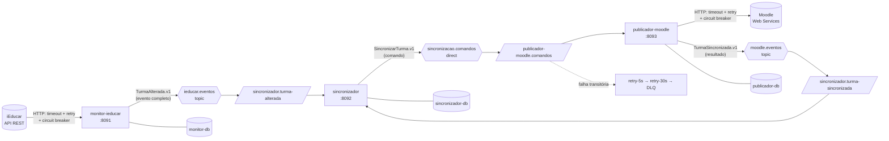

# T2 — Integração iEducar → Moodle em microsserviços

Trabalho 2 da disciplina **Projeto e Arquitetura de Software** (PUCRS). O T1 era **um único programa** (monólito) que lia
o iEducar e escrevia no Moodle. O T2 reprojeta a mesma integração como **três microsserviços independentes que conversam
por mensagens** (RabbitMQ), tolerando falhas e podendo ser observados em execução.

> Em uma frase: o iEducar muda → o **monitor** percebe → o **sincronizador** decide e registra → o **publicador** aplica no
> Moodle. Cada passo é um serviço com o seu próprio banco, ligados só por filas.

## 1. Os três serviços

| Serviço | O que faz (uma responsabilidade) | Banco próprio | Porta |
|---|---|---|---|
| `monitor-ieducar` | De tempos em tempos lê o iEducar (com timeout, retry e circuit breaker), compara cada turma com o que já foi visto (hash SHA-256) e, se mudou, publica o evento `TurmaAlterada.v1` | `monitor-db` | 8091 |
| `sincronizador` | Recebe o evento, descarta duplicatas, guarda o **estado de cada turma** e o **mapeamento iEducar ↔ Moodle**, e manda o comando `SincronizarTurma.v1`; depois recebe o resultado `TurmaSincronizada.v1` | `sincronizador-db` | 8092 |
| `publicador-moodle` | Recebe o comando e aplica no Moodle (categoria → curso → usuários → inscrições), com timeout, retry, circuit breaker, filas de retry e DLQ | `publicador-db` | 8093 |

Regras que valem para os três: Java 17 + Spring Boot 4, arquitetura hexagonal (domínio / aplicação / adaptadores), **nenhum
código compartilhado**, nenhum serviço lê o banco de outro. O critério de decomposição (por capacidade de negócio) está no
[ADR 0001](docs/adr/0001-decomposicao-por-capacidade-de-negocio.md).

## 2. Como as peças conversam



Toda mensagem leva um **correlationId** que nasce na varredura do monitor e é copiado pelos três serviços. Com ele dá para
seguir **uma** mudança de ponta a ponta nos logs. O contrato completo (formato das mensagens, filas, tabelas, endpoints) está em
[`docs/contratos.md`](docs/contratos.md).

## 3. Pré-requisitos

- **Docker Desktop** (Windows com WSL2, macOS ou Linux) com Compose v2. Não é preciso instalar Java nem Maven para rodar:
  os `Dockerfile`s compilam os serviços dentro do Docker.
- ~8 GB de RAM livres para o Docker. Disco: ~15 GB com iEducar e Moodle reais; bem menos no modo com fakes.
- Internet na primeira execução (baixa imagens e dependências).
- **Portas livres**: 8080, 8081, 8091, 8092, 8093, 5672, 15672, 3000, 9090, 16686, 4318.
  O T1 usa as mesmas 8080/8081 — se o ambiente do T1 estiver no ar, pare-o antes (`docker compose down` na pasta do T1).
- Windows/PowerShell: os scripts `.ps1` funcionam no PowerShell 5.1 ou 7. Se o Windows bloquear a execução, rode uma vez na
  janela atual: `Set-ExecutionPolicy -Scope Process -ExecutionPolicy Bypass`.

## 4. Como rodar

Há dois modos. Eles usam as mesmas portas 8080/8081, então **use um de cada vez**.

### Modo A — com iEducar e Moodle reais

A pasta `docker/` (com `docker/ieducar` e `docker/moodle`) vem do T1 e é usada pelo compose para construir o iEducar e
configurar o Moodle. Ela precisa estar na raiz deste projeto (`T2-Microsservicos_Projac/docker/`).

```powershell
# 1) (opcional) personalizar portas, tokens e senhas
Copy-Item .env.example .env          # bash: cp .env.example .env

# 2) construir e subir tudo (infra + iEducar + Moodle + 3 microsserviços)
docker compose up -d --build
```

Tempos aproximados (iguais aos do T1): o **build** do iEducar leva alguns minutos; o primeiro boot leva ~2 min no iEducar e
~5 min no Moodle (instalação). O `monitor-ieducar` só inicia quando o iEducar estiver saudável, e o `publicador-moodle` quando
o Moodle estiver saudável. Acompanhe com `docker compose ps` (todos devem ficar `healthy`).

O iEducar vem vazio. Crie os dados de exemplo (1 escola, 2 cursos, 3 turmas, alunos e professores):

```powershell
docker compose exec ieducar demo-seed base
# para a demonstração ao vivo, cria UMA turma nova (2 alunos + 1 professor):
docker compose exec ieducar demo-seed nova-turma
```

Pronto: dentro de ~1 minuto o monitor encontra as turmas sozinho, ou dispare já (seção 6).

### Modo B — rápido, com iEducar e Moodle FALSOS (recomendado para ensaiar)

`tools/fakes/fake_sistemas.py` imita as APIs do iEducar e do Moodle (com dados iniciais: 2 cursos, 3 turmas, 6 alunos,
2 professores). Sobe em ~1–2 minutos, sem esperar os sistemas reais, e permite mudar o "iEducar" ao vivo.

```powershell
.\scripts\subir-com-fakes.ps1          # bash: ./scripts/subir-com-fakes.sh
.\scripts\subir-com-fakes.ps1 -Parar   # remove os containers fake (bash: ./scripts/subir-com-fakes.sh parar)
```

O script sobe a infraestrutura, os dois fakes (na rede do compose, com os nomes `ieducar` e `moodle`, então nenhuma
configuração muda) e os três serviços. Não precisa da pasta `docker/`.

Alguns comandos úteis do fake (iEducar fake em `localhost:8080`, Moodle fake em `localhost:8081`):

```powershell
curl.exe "http://localhost:8080/__admin/renomear-turma?id=3&nome=Turma+Renomeada"
curl.exe "http://localhost:8080/__admin/nova-turma?curso=1&nome=Turma+Z"
curl.exe "http://localhost:8080/__admin/adicionar-aluno?turma=3&nome=Fulano+de+Tal"
curl.exe "http://localhost:8081/__admin/estado"      # o que existe no "Moodle" agora
```

(No bash, use `curl` no lugar de `curl.exe`. A lista completa está no cabeçalho de `tools/fakes/fake_sistemas.py`.)

## 5. Endereços e credenciais

| O quê | URL | Acesso |
|---|---|---|
| iEducar (real ou fake) | http://localhost:8080 | `admin` / `123456789` (real) |
| Moodle (real ou fake) | http://localhost:8081 | `admin` / `Admin@12345` (real) |
| RabbitMQ (painel) | http://localhost:15672 | `guest` / `guest` |
| Grafana | http://localhost:3000 (dashboard: `/d/integracao-t2`) | `admin` / `admin` (leitura anônima liberada) |
| Jaeger (traces) | http://localhost:16686 | — |
| Prometheus | http://localhost:9090 | — |
| monitor-ieducar | http://localhost:8091 | `POST /api/varreduras`, `POST /api/varreduras/completa`, `GET /api/varreduras/ultima`, `GET /api/snapshots` |
| sincronizador | http://localhost:8092 | `GET /api/estado`, `GET /api/estado/{turmaId}`, `GET /api/mapeamentos` |
| publicador-moodle | http://localhost:8093 | `GET /api/comandos`, `GET /api/dlq`, `POST /api/dlq/reprocessar`, `GET/POST /api/falhas/moodle` |

Todos os serviços expõem também `/actuator/health` e `/actuator/prometheus`. O endpoint `/api/falhas/moodle` só existe com
`FALHA_INJETAVEL=true` (padrão do compose); sem a flag responde 404.

## 6. Roteiro para reproduzir uma sincronização completa

1. Suba o ambiente (modo A ou B) e confirme: `docker compose ps` com os serviços `healthy`.
2. Em **outro terminal**, abra a "conversa" entre os serviços ao vivo:

   ```powershell
   .\scripts\acompanhar.ps1                 # bash: ./scripts/acompanhar.sh
   ```

3. Dispare uma varredura (no modo A, só depois do `demo-seed base`):

   ```powershell
   Invoke-RestMethod -Method Post http://localhost:8091/api/varreduras     # bash/curl: curl -X POST localhost:8091/api/varreduras
   ```

   Nos logs aparecem, na ordem: `[VARREDURA]` e `[HTTP-OUT]` (monitor lendo o iEducar) → `[PUBLICA]` `TurmaAlterada.v1` com
   "confirmado pelo broker" → `[RECEBE]` / `[PROCESSA]` / `[PUBLICA]` `SincronizarTurma.v1` (sincronizador) → `[RECEBE]` /
   `[HTTP-OUT]` Moodle / `[RESULTADO]` (publicador) → `[RECEBE]` `TurmaSincronizada.v1` / `[RESULTADO]` ... `SINCRONIZADA`
   (sincronizador). Todas as linhas da mesma mudança têm o mesmo `corr=`.
4. Veja o resultado: `.\scripts\status.ps1` (última varredura, estado das turmas, mapeamentos, comandos, DLQ e filas) ou
   `curl.exe http://localhost:8092/api/estado`. No Moodle fake: `curl.exe http://localhost:8081/__admin/estado`; no Moodle real:
   http://localhost:8081 → *Administração do site → Cursos → Gerenciar cursos e categorias*.
5. Mude algo no iEducar (fake: `.../__admin/renomear-turma?id=3&nome=...`; real: `docker compose exec ieducar demo-seed nova-turma`)
   e dispare outra varredura. Só a turma alterada gera mensagens (`inalteradas=2` no log da varredura).
6. Dispare mais uma varredura sem mudar nada: `publicadas=0 inalteradas=3`. Nada é reenviado — o monitor compara hashes.

Para acompanhar **uma** mudança: `.\scripts\acompanhar.ps1 -Corr <correlationId>` (o id aparece na resposta do `POST /api/varreduras`)
ou `-Turma 3` para uma turma. Parâmetros no bash: `-c`, `-t`, `-s` (janela, ex.: `10m`).

## 7. Cenários de falha

O kickoff pede quatro cenários de falha; cada um tem **um script** (os três últimos são extras). Detalhes, trechos reais de log e
explicação de por que funciona em [`docs/failure-scenarios.md`](docs/failure-scenarios.md). Cada script imprime o que está
fazendo e o que observar nos logs:

```powershell
.\scripts\cenarios\1-ieducar-fora.ps1        # [kickoff 1] iEducar fora: timeout + retry + circuit breaker
.\scripts\cenarios\2-moodle-fora.ps1         # [kickoff 2] Moodle fora: retry-5s -> retry-30s -> DLQ -> reprocesso
.\scripts\cenarios\3-resposta-perdida.ps1    # [kickoff 3] Moodle CRIA o curso, mas a resposta se perde: nada duplica
.\scripts\cenarios\4-reinicio-no-meio.ps1    # [kickoff 4] publicador morto no meio: mensagem reentregue, reprocesso idempotente
.\scripts\cenarios\5-mensagem-duplicada.ps1  # (extra) mesma mensagem duas vezes: idempotência
.\scripts\cenarios\6-rabbitmq-fora.ps1       # (extra) RabbitMQ fora: publisher confirm, snapshot não avança
.\scripts\cenarios\7-mensagem-veneno.ps1     # (extra) mensagem ilegível: vai para a DLQ do sincronizador
```

(bash: `./scripts/cenarios/N-nome.sh`.) Os scripts detectam sozinhos se os sistemas são reais ou fakes. No modo real, os
cenários 2 e 6 mudam o nome da primeira turma ativa por SQL — rode antes o `demo-seed base` — e o cenário 1 para e religa o
container do iEducar (`docker compose stop ieducar` / `start`). Os cenários 3, 4, 5 e 7 publicam eventos sintéticos direto no
RabbitMQ (e deixam alguns dados de demonstração no Moodle).

Os cenários 2, 3 e 4 usam as **falhas injetáveis** do publicador (só com `FALHA_INJETAVEL=true`):
`POST http://localhost:8093/api/falhas/moodle` com qualquer subconjunto de `{"indisponivel":true,"perderRespostaNaCriacao":1,"latenciaMs":1500}`
(`GET` mostra o estado). O estado vive só em memória e some ao reiniciar o container.

## 8. Parar, limpar, reiniciar

```powershell
docker compose stop                                   # para tudo, mantém os dados
docker compose start                                  # volta
.\scripts\subir-com-fakes.ps1 -Parar                  # remove os containers fake (modo B)
docker compose down                                   # remove os containers (mantém volumes/dados)
docker compose down -v                                # remove TAMBÉM os volumes: começa do zero
```

Para ver só um serviço: `docker compose logs -f sincronizador`. Reiniciar um serviço: `docker compose restart publicador-moodle`.

## 9. Variáveis (`.env`)

Copie `.env.example` para `.env` para personalizar; todos os valores já são o padrão do compose. As principais:

| Variável | Padrão | Para que serve |
|---|---|---|
| `IEDUCAR_PORT`, `MOODLE_PORT`, `MONITOR_PORT`, `SINCRONIZADOR_PORT`, `PUBLICADOR_PORT` | 8080, 8081, 8091, 8092, 8093 | portas no seu computador |
| `MONITOR_INTERVALO` | `PT1M` | intervalo entre varreduras (ISO-8601; `PT15S` é bom para demonstração) |
| `MONITOR_ATRASO_INICIAL` | `PT20S` | espera antes da 1ª varredura automática |
| `LOG_FORMATO` | `texto` | `texto` (legível) ou `json` (estruturado, com `correlationId` e `traceId`) |
| `FALHA_INJETAVEL` | `true` | liga o endpoint de falhas injetáveis do Moodle: fora do ar, resposta perdida após criar, latência (cenários 2, 3 e 4) |
| `IEDUCAR_API_TOKEN`, `IEDUCAR_API_ACCESS_KEY`, `IEDUCAR_API_SECRET_KEY` | ver `.env.example` | credenciais do iEducar |
| `MOODLE_WS_TOKEN`, `MOODLE_SENHA_INICIAL`, `MOODLE_PAPEL_ALUNO_ID`, `MOODLE_PAPEL_PROFESSOR_ID` | ver `.env.example` | acesso e regras do Moodle |
| `RABBITMQ_USER`, `RABBITMQ_PASSWORD` | `guest` / `guest` | broker |

Parâmetros de resiliência (timeouts, retry, circuit breaker) têm padrões no contrato (3 s de conexão, 10 s de leitura, 3
tentativas com espera de 500 ms dobrando, circuito aberto por 20 s) e podem ser ajustados por variáveis `RESILIENCIA_*` em
cada serviço (ver `application.properties`).

## 10. Testes automatizados

Cada serviço tem testes JUnit que **não precisam de Docker** (usam fakes em memória):

| Serviço | Testes | Cobrem |
|---|---|---|
| `monitor-ieducar` | 30 | hash canônico, varredura (só publica mudanças; falha de publicação não avança o snapshot; iEducar fora → nada publicado), cliente do iEducar, retry e circuit breaker |
| `sincronizador` | 18 | idempotência por `eventId`, estado e versão por turma, resultado obsoleto, mapeamentos, parse tolerante, mensagem veneno |
| `publicador-moodle` | 59 | sincronização de uma turma, reexecução idempotente, inbox/duplicata/obsoleto, política de retry por fila, DLQ, cliente do Moodle, resiliência, convergência após resposta perdida, `eventId` do resultado |

```powershell
cd services\monitor-ieducar; mvn -q test        # idem em services\sincronizador e services\publicador-moodle
```

Requer JDK 17 e Maven na máquina. Sem eles, use o container do Maven (dentro da pasta do serviço):
`docker run --rm -v "${PWD}:/app" -w /app maven:3.9-eclipse-temurin-17 mvn -q test`.

## 11. Estrutura de pastas

```text
T2-Microsservicos_Projac/
├── docker-compose.yml          # tudo: broker, bancos, observabilidade, 3 serviços, iEducar e Moodle reais
├── .env.example                # variáveis (copie para .env)
├── docker/                     # (vem do T1) docker/ieducar e docker/moodle, usados só no modo A
├── services/
│   ├── monitor-ieducar/        # cada serviço: pom.xml, Dockerfile, src/ (domain, application, adapter, config)
│   ├── sincronizador/
│   └── publicador-moodle/
├── observabilidade/            # prometheus.yml, dashboard do Grafana, plugins do RabbitMQ
├── tools/fakes/                # iEducar e Moodle falsos para ensaio e testes
├── scripts/                    # subir-com-fakes, acompanhar, status (.ps1 e .sh) e cenarios/
└── docs/
    ├── contratos.md            # mensagens, filas, tabelas, endpoints, convenções de log
    ├── architecture.md         # C4, sequência, catálogo de eventos, comparação com o T1
    ├── failure-scenarios.md    # os cenários de falha, passo a passo
    ├── ROTEIRO_APRESENTACAO.md # roteiro da apresentação + perguntas prováveis
    └── adr/                    # decisões arquiteturais (decomposição, comunicação, resiliência, stack...)
```

## 12. Solução de problemas

- **Docker Hub devolve `429 Too Many Requests` ao baixar imagens**: é limite de downloads anônimos. Faça `docker login` (conta
  gratuita) ou espere alguns minutos e rode de novo. As imagens já baixadas ficam em cache.
- **Build do iEducar falha em `composer`** (`Could not authenticate against github.com`): crie o `.env` e descomente
  `COMPOSER_INSTALL_FLAGS=--prefer-source`. O aviso de segurança do Composer 2.10 (`PKSA-...`) já é tratado no Dockerfile do T1.
- **Build dos serviços falha no Maven com erro `PKIX`**: a rede (empresa/faculdade) intercepta HTTPS. Tente em outra rede.
- **`port is already allocated` / porta ocupada**: algo já usa a porta (o ambiente do T1 usa 8080/8081). Pare-o ou troque a
  porta no `.env`. No Windows: `netstat -ano | findstr :8080`.
- **RabbitMQ não sobe ou fica `unhealthy`**: veja `docker compose logs rabbitmq`. O arquivo
  `observabilidade/rabbitmq/enabled_plugins` precisa ter quebras de linha **LF**; se o Git no Windows converter para CRLF, o
  RabbitMQ não lê a lista de plugins — restaure com `git checkout -- observabilidade/rabbitmq/enabled_plugins` após configurar
  `git config core.autocrlf input`. Se o volume estiver corrompido: `docker compose down -v` e suba de novo (apaga os dados).
- **Os serviços sobem mas nada acontece**: no modo A, rode o `demo-seed base` (o iEducar vem vazio). Veja o resultado da última
  varredura em http://localhost:8091/api/varreduras/ultima (o campo `erro` diz o motivo).
- **Acentos aparecem quebrados no terminal**: use PowerShell 7 ou rode `chcp 65001` antes.
- **Scripts `.ps1` bloqueados**: `Set-ExecutionPolicy -Scope Process -ExecutionPolicy Bypass`.

## 13. Requisitos do kickoff × onde estão atendidos

| Requisito (kickoff do T2) | Onde |
|---|---|
| Stack livre, justificada em ADR | [`docs/adr/0004-stack-e-nomes-em-portugues.md`](docs/adr/0004-stack-e-nomes-em-portugues.md) |
| Tudo sobe com um único `docker compose up` (serviços, broker, bancos, iEducar e Moodle ou simuladores) | `docker-compose.yml` (reais) e `scripts/subir-com-fakes` + `tools/fakes` (simuladores) |
| ≥ 3 serviços coesos, critério de decomposição em ADR | `services/*` e [ADR 0001](docs/adr/0001-decomposicao-por-capacidade-de-negocio.md) |
| Cada serviço dono dos próprios dados; ninguém acessa o banco de outro | 3 bancos Postgres no compose; [`docs/contratos.md`](docs/contratos.md) §1 e §6 |
| Message broker com eventos de nome, formato e versão documentados | RabbitMQ; [`docs/contratos.md`](docs/contratos.md) §2–§4; catálogo em [`docs/architecture.md`](docs/architecture.md); [ADR 0002](docs/adr/0002-comunicacao-assincrona-rabbitmq.md) |
| REST/gRPC onde fizer sentido, justificado | HTTP só nas bordas (monitor → iEducar, publicador → Moodle), que são APIs REST externas; ADR 0002 |
| Consumidores idempotentes | tabelas `evento_processado` (sincronizador) e `comando_processado` (publicador), busca por `idnumber` antes de criar no Moodle; cenários 3, 4 e 5 |
| Timeout, retry com backoff e circuit breaker nas chamadas ao iEducar e ao Moodle | `Resiliencia` (monitor) e `MoodleResiliente` (publicador); [ADR 0003](docs/adr/0003-resiliencia.md); cenários 1 e 2 |
| Dead-letter queue sem bloquear o fluxo | `publicador-moodle.comandos.dlq` e `sincronizador.*.dlq`; cenários 2 e 7 |
| Quatro cenários de falha demonstráveis (iEducar fora, Moodle fora, resposta perdida, reinício no meio) | [`docs/failure-scenarios.md`](docs/failure-scenarios.md) e `scripts/cenarios/1-` a `4-` (extras: `5-` a `7-`) |
| Logs estruturados com correlation ID em todos os serviços | padrão de log com `corr=`; `LOG_FORMATO=json`; `scripts/acompanhar` |
| Health checks | `/actuator/health` em todos os serviços; `healthcheck` de cada container no compose |
| Métricas (mensagens, falhas, tempos) | `/actuator/prometheus`, Prometheus e dashboard do Grafana |
| Tracing distribuído (desejável) | OpenTelemetry → Jaeger (um trace atravessa os três serviços) |
| README com execução e roteiro de sincronização completa | este arquivo, seções 4 e 6 |
| `docs/architecture.md` com catálogo de eventos e comparação com o T1 | [`docs/architecture.md`](docs/architecture.md) |
| ADRs de decomposição, comunicação, resiliência e stack | [`docs/adr/`](docs/adr/) |
| Apresentação individual com demonstração ao vivo e ≥ 1 cenário de falha | [`docs/ROTEIRO_APRESENTACAO.md`](docs/ROTEIRO_APRESENTACAO.md) |

## 14. Documentação

- [`docs/contratos.md`](docs/contratos.md) — contratos entre os serviços (fonte de verdade)
- [`docs/architecture.md`](docs/architecture.md) — arquitetura, fluxos e comparação com o T1
- [`docs/adr/`](docs/adr/) — decisões arquiteturais
- [`docs/failure-scenarios.md`](docs/failure-scenarios.md) — cenários de falha
- [`docs/ROTEIRO_APRESENTACAO.md`](docs/ROTEIRO_APRESENTACAO.md) — roteiro e perguntas prováveis
- [`tools/fakes/README.md`](tools/fakes/README.md) — iEducar e Moodle falsos
