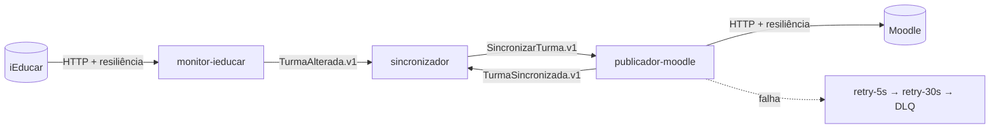

# T2 – Integração iEducar → Moodle com microsserviços

Trabalho 2 de Projeto e Arquitetura de Software (PUCRS, prof. José Pedro Schardosim Simão).
Autores: João Oliveira Galeazzi e Josias Rocha.

No T1 a gente fez um monólito que lia o iEducar e escrevia no Moodle. Aqui a mesma integração foi dividida em **três serviços** que só conversam por mensagens (RabbitMQ), cada um com seu próprio banco. A ideia é que, se um lado cair, o resto continue de pé e a integração se recupere sozinha.

Resumindo: o iEducar muda → o **monitor** percebe → o **sincronizador** registra e manda o comando → o **publicador** aplica no Moodle.

## Os três serviços

| Serviço | O que faz | Banco | Porta |
|---|---|---|---|
| `monitor-ieducar` | Lê o iEducar de tempos em tempos (com timeout, retry e circuit breaker), calcula um hash de cada turma e, se mudou, publica o evento `TurmaAlterada.v1` | `monitor-db` | 8091 |
| `sincronizador` | Recebe o evento, ignora repetidos, guarda o estado de cada turma e o mapeamento iEducar ↔ Moodle, e manda o comando `SincronizarTurma.v1` | `sincronizador-db` | 8092 |
| `publicador-moodle` | Recebe o comando e cria/atualiza categoria, curso, usuários e inscrições no Moodle, com retry, circuit breaker, filas de retry e DLQ | `publicador-db` | 8093 |

Nenhum serviço lê o banco do outro e não compartilhamos código. Cada um usa arquitetura hexagonal (domínio, aplicação, adaptadores).



Toda mensagem carrega um `correlationId` que nasce na varredura do monitor; com ele dá para seguir uma mudança inteira nos logs.

## O que precisa ter instalado

- Docker Desktop (no Windows, com WSL2) e o Docker Compose v2. **Não precisa de Java nem Maven para rodar**: os Dockerfiles compilam tudo dentro do Docker.
- Uns 8 GB de RAM livres para o Docker.
- Internet na primeira vez (baixa imagens e dependências).
- Portas livres: 8080, 8081, 8091, 8092, 8093, 5672, 15672, 3000, 9090, 16686. Se o ambiente do T1 estiver rodando, pare ele antes (usa 8080 e 8081).
- Se o PowerShell bloquear os scripts: `Set-ExecutionPolicy -Scope Process -ExecutionPolicy Bypass`.

## Como rodar (jeito rápido, com iEducar e Moodle falsos)

Para ensaiar e para a apresentação usamos fakes em Python (`tools/fakes/fake_sistemas.py`) que imitam as APIs dos dois sistemas. Sobe em poucos minutos e dá para derrubar e mexer neles ao vivo.

1. Abra o Docker Desktop e espere ele ficar verde.
2. No PowerShell, entre na pasta do projeto e rode:
   ```powershell
   .\scripts\subir-com-fakes.ps1
   ```
   (bash: `./scripts/subir-com-fakes.sh`). O script sobe RabbitMQ, os 3 bancos, os fakes e os 3 serviços. Na primeira vez demora, porque compila os serviços.
3. Confira se está tudo no ar:
   ```powershell
   docker compose ps
   .\scripts\status.ps1
   ```
   Os três serviços devem aparecer como `healthy`.

Não é preciso criar `.env`: o compose já tem valores padrão. Se quiser mudar porta, intervalo (`MONITOR_INTERVALO`), formato de log (`LOG_FORMATO=json`) etc., crie um arquivo `.env` com só as variáveis que quer trocar.

Para parar: `docker compose stop` (mantém dados), `docker compose down` (remove containers), `docker compose down -v` (apaga tudo e começa do zero). Os fakes saem com `.\scripts\subir-com-fakes.ps1 -Parar`.

## Rodar com o iEducar e o Moodle reais

A pasta `docker/` veio do T1 e precisa estar na raiz do projeto.

```powershell
docker compose up -d --build
docker compose exec ieducar demo-seed base          # cria escola, cursos, turmas, alunos e professores
docker compose exec ieducar demo-seed nova-turma    # cria uma turma nova (para a demo)
```

O build do iEducar leva alguns minutos e o Moodle leva uns 5 minutos para instalar no primeiro boot. **Esse modo a gente não rodou na rodada de testes final**; os testes que citamos abaixo foram com os fakes. Os modos usam as mesmas portas 8080/8081, então use um por vez.

## Endereços

| O quê | URL | Login |
|---|---|---|
| RabbitMQ (painel) | http://localhost:15672 | guest / guest |
| Grafana | http://localhost:3000 | admin / admin |
| Jaeger | http://localhost:16686 | — |
| Prometheus | http://localhost:9090 | — |
| monitor | http://localhost:8091 | `POST /api/varreduras`, `POST /api/varreduras/completa`, `GET /api/varreduras/ultima`, `GET /api/snapshots` |
| sincronizador | http://localhost:8092 | `GET /api/estado`, `GET /api/estado/{turmaId}`, `GET /api/mapeamentos` |
| publicador | http://localhost:8093 | `GET /api/comandos`, `GET /api/dlq`, `POST /api/dlq/reprocessar`, `GET/POST /api/falhas/moodle` |

Todo serviço tem `/actuator/health` e `/actuator/prometheus`. O endpoint `/api/falhas/moodle` só existe com `FALHA_INJETAVEL=true` (já é o padrão do compose).

## Roteiro de uma sincronização completa

1. Suba o ambiente (acima).
2. Em outro terminal, deixe os logs dos três serviços juntos:
   ```powershell
   .\scripts\acompanhar.ps1
   ```
3. Dispare uma varredura:
   ```powershell
   Invoke-RestMethod -Method Post http://localhost:8091/api/varreduras
   ```
   Nos logs você vê, na ordem: `[VARREDURA]` e `[HTTP-OUT]` (monitor lendo o iEducar), `[PUBLICA]` do `TurmaAlterada.v1`, `[RECEBE]`/`[PROCESSA]`/`[PUBLICA]` do `SincronizarTurma.v1` (sincronizador), `[RECEBE]`/`[HTTP-OUT]`/`[RESULTADO]` (publicador) e por fim `SINCRONIZADA` no sincronizador. Todas as linhas dessa mudança têm o mesmo `corr=`.
4. Veja o resultado:
   ```powershell
   Invoke-RestMethod http://localhost:8092/api/estado
   Invoke-RestMethod http://localhost:8081/__admin/estado    # o que existe no Moodle fake
   ```
5. Mude algo no iEducar fake e varra de novo:
   ```powershell
   Invoke-RestMethod "http://localhost:8080/__admin/renomear-turma?id=3&nome=Turma+Renomeada"
   Invoke-RestMethod -Method Post http://localhost:8091/api/varreduras
   ```
   Só a turma alterada gera mensagens.
6. Varra de novo sem mudar nada: `eventosPublicados=0`, tudo `inalterada`.

Outros comandos do fake: `nova-turma`, `adicionar-aluno`, `adicionar-professor`, `cancelar-matricula`, `inativar-turma`, `down?seconds=0` (derruba), `up`, `reset` (lista completa no cabeçalho do `fake_sistemas.py`).

Para acompanhar uma mudança só: `.\scripts\acompanhar.ps1 -Corr <correlationId>` (o id vem na resposta do `POST /api/varreduras`).

## Cenários de falha

Cada um tem um script e está explicado em [`docs/failure-scenarios.md`](docs/failure-scenarios.md):

```powershell
.\scripts\cenarios\1-ieducar-fora.ps1        # iEducar fora: retry + circuit breaker
.\scripts\cenarios\2-moodle-fora.ps1         # Moodle fora: retry-5s → retry-30s → DLQ → reprocesso
.\scripts\cenarios\3-resposta-perdida.ps1    # Moodle cria o curso mas a resposta se perde: não duplica
.\scripts\cenarios\4-reinicio-no-meio.ps1    # publicador morre no meio: mensagem volta e termina sem duplicar
.\scripts\cenarios\5-mensagem-duplicada.ps1  # extra: idempotência
.\scripts\cenarios\6-rabbitmq-fora.ps1       # extra: RabbitMQ fora
.\scripts\cenarios\7-mensagem-veneno.ps1     # extra: mensagem ilegível vai para a DLQ
```

(bash: `./scripts/cenarios/N-nome.sh`.) As falhas injetáveis do Moodle ficam em `POST http://localhost:8093/api/falhas/moodle`, com `{"indisponivel":true,"perderRespostaNaCriacao":1,"latenciaMs":1500}` (qualquer parte). Elas só existem em memória e somem se o container reiniciar.

## Validação dos casos (o que a gente testou de verdade)

Rodamos, com os fakes, em 26/11/2026:

- **Testes unitários:** 30 (monitor), 18 (sincronizador) e 59 (publicador), todos passando.
- **`scripts/validar-casos.ps1`:** 15 verificações, 15 passaram: cadastro de turma com professor e aluno, atualização (renomear) sem duplicar, iEducar fora, Moodle fora (com DLQ e reprocesso) e os dois fora ao mesmo tempo.
- **Cenário 3 (resposta perdida):** o curso existia ao repetir, `cursosCriados=0`, turma `SINCRONIZADA`.
- **Cenário 4 (kill no meio):** `docker kill` no publicador, mensagem reentregue, turma `SINCRONIZADA` sem DLQ.

Para repetir:
```powershell
.\scripts\subir-com-fakes.ps1
.\scripts\validar-casos.ps1 *> resultado-validacao.txt
```

Para os testes unitários (precisa de JDK 17 e Maven; ou use o container do Maven):
```powershell
cd services\monitor-ieducar; mvn test
cd ..\sincronizador; mvn test
cd ..\publicador-moodle; mvn test
```
Sem Maven instalado: `docker run --rm -v "${PWD}:/app" -w /app maven:3.9-eclipse-temurin-17 mvn test`.

## Limitações conhecidas

- A turma que é **apagada** do iEducar não gera evento (turma **inativada** funciona: o curso fica oculto no Moodle).
- `GET /api/varreduras/ultima` mostra 0 em "inalteradas" e "falhas" (o `POST` devolve certo).
- O reprocesso da DLQ é manual, de propósito.
- As APIs de operação não têm autenticação (só para ambiente acadêmico).
- Ainda não rodamos o modo com iEducar e Moodle reais depois das últimas mudanças.

## Problemas comuns

- **429 do Docker Hub:** faça `docker login` ou espere um pouco.
- **Porta ocupada:** `netstat -ano | findstr :8080`; pare o ambiente do T1.
- **RabbitMQ não sobe:** `docker compose logs rabbitmq`. O arquivo `observabilidade/rabbitmq/enabled_plugins` precisa estar com quebra de linha LF (`git config core.autocrlf input`).
- **Nada acontece:** veja `http://localhost:8091/api/varreduras/ultima` (o campo `erro` explica). No modo real, falta rodar o `demo-seed base`.
- **Acentos quebrados:** use PowerShell 7 ou `chcp 65001`.

## Estrutura

```text
docker-compose.yml     broker, bancos, observabilidade, 3 serviços, iEducar e Moodle reais
docker/                (vem do T1) usado só no modo real
services/              monitor-ieducar, sincronizador, publicador-moodle
observabilidade/       Prometheus, Grafana, plugins do RabbitMQ
tools/fakes/           iEducar e Moodle falsos
scripts/               subir, acompanhar, status, validar-casos e cenarios/
docs/                  contratos, architecture, failure-scenarios, ROTEIRO_APRESENTACAO e adr/
```

## Documentação

[`docs/contratos.md`](docs/contratos.md) · [`docs/architecture.md`](docs/architecture.md) · [`docs/adr/`](docs/adr/) · [`docs/failure-scenarios.md`](docs/failure-scenarios.md) · [`docs/ROTEIRO_APRESENTACAO.md`](docs/ROTEIRO_APRESENTACAO.md)
