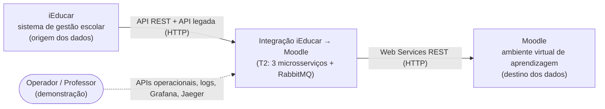
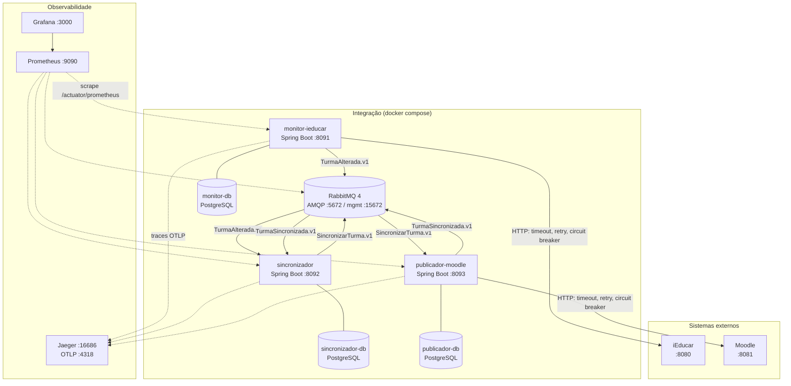
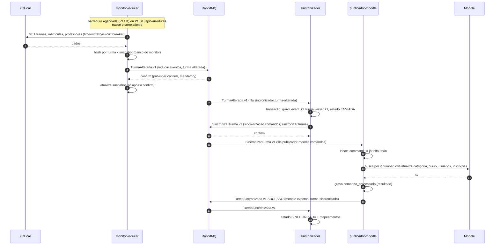
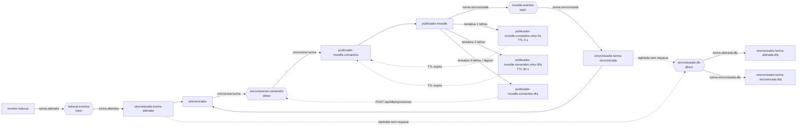
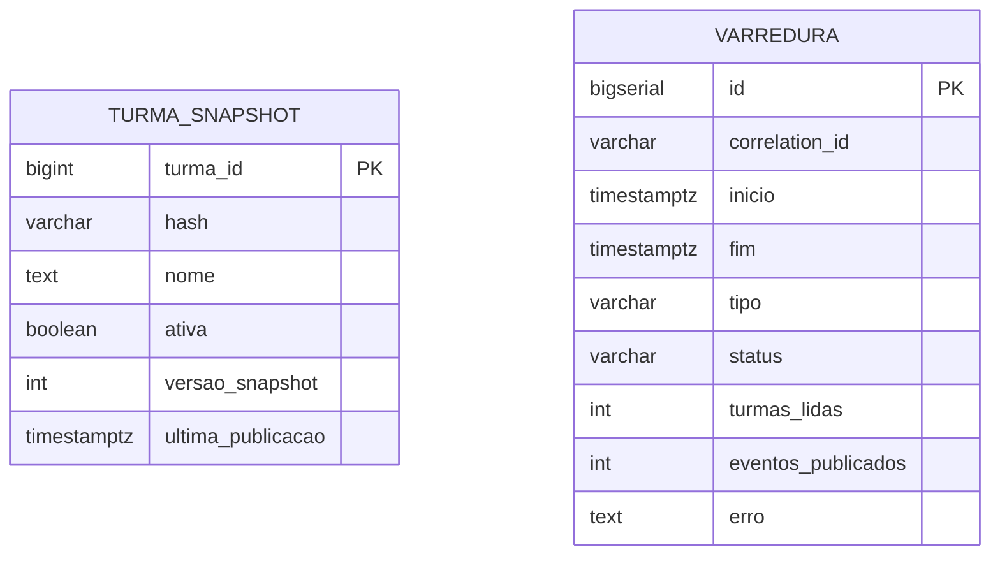
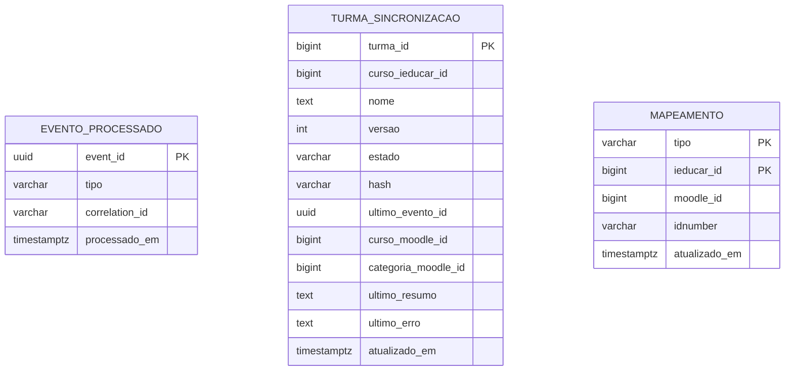
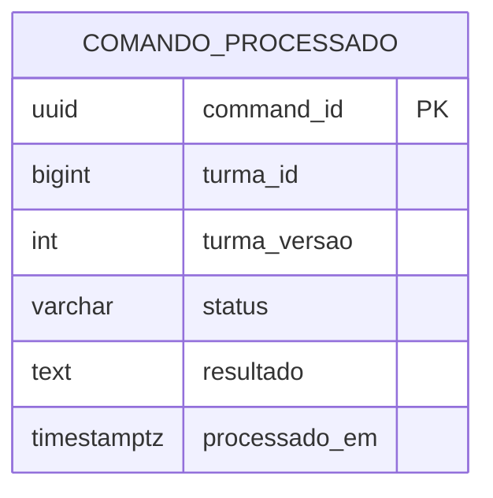

# Arquitetura do T2 — Integração iEducar → Moodle com microsserviços

> Documento de arquitetura do T2 (Projeto e Arquitetura de Software, PUCRS). Contratos exatos das mensagens:
> [`contratos.md`](contratos.md). Decisões e trade-offs: [`adr/`](adr/). Cenários de falha: `failure-scenarios.md`.

## 1. A ideia em linguagem simples

Imagine uma escola (**iEducar**) que guarda quem são os alunos e em que turma cada um está, e uma sala de aula virtual
(**Moodle**) que precisa ficar igual. No T1 uma única pessoa fazia tudo: olhava a secretaria, decidia o que tinha mudado,
anotava quem é quem nos dois sistemas e digitava no Moodle. Se ela adoecesse, tudo parava.

No T2 dividimos o trabalho entre **três pessoas** que **não conversam cara a cara**: deixam **bilhetes** em uma
**caixa de correio** (o **RabbitMQ**) que guarda o bilhete até a pessoa certa pegar:

1. O **vigia** (`monitor-ieducar`) olha a secretaria de tempos em tempos, compara com o que já anotou e, quando algo
   mudou numa turma, deixa o bilhete *"a turma 10 mudou, e esta é a lista completa"* (**evento** `TurmaAlterada`).
2. A **coordenadora** (`sincronizador`) lê o bilhete, anota em seu caderno em que estado está cada turma e quem é quem nos
   dois sistemas (o **mapeamento**), e deixa para o digitador o bilhete *"deixe a turma 10 assim no Moodle"*
   (**comando** `SincronizarTurma`).
3. O **digitador** (`publicador-moodle`) lança tudo no Moodle e devolve o bilhete *"turma 10 pronta"* (**resultado**
   `TurmaSincronizada`) para a coordenadora atualizar o caderno.

Se o Moodle estiver fora, o digitador **tenta de novo** depois de 5 segundos, depois de 30, e se ainda não der coloca o
bilhete numa **gaveta de pendências** (a *dead-letter queue*) para ser refeito quando o Moodle voltar. Nenhum bilhete se
perde, e se o mesmo bilhete chegar duas vezes ninguém faz o trabalho em dobro (**idempotência**).

O resto deste documento detalha cada peça.

## 2. Visão de contexto e de contêineres (C4, notação simplificada)

### Nível 1 — Contexto



### Nível 2 — Contêineres



Cada serviço tem **banco próprio** e só ele o acessa ([ADR 0005](adr/0005-dados-por-servico.md)). A única ponte entre
serviços é o RabbitMQ.

## 3. Como os serviços foram separados

Decomposição **por capacidade de negócio** (não por entidade): detectar mudanças, manter a integração (mapeamento e
estado) e aplicar no Moodle — [ADR 0001](adr/0001-decomposicao-por-capacidade-de-negocio.md).

| Serviço | Porta | Faz | Não faz |
|---|---|---|---|
| `monitor-ieducar` | 8091 | Lê o iEducar (turmas, matrículas, professores), calcula o **hash canônico** (SHA-256) por turma, compara com o snapshot, publica `TurmaAlterada.v1` com *publisher confirm* e só então atualiza o snapshot | Não conhece o Moodle nem o mapeamento |
| `sincronizador` | 8092 | Consome eventos (idempotente), mantém a `versao` e o `estado` por turma, emite `SincronizarTurma.v1`, consome `TurmaSincronizada.v1`, guarda o **mapeamento** | Não fala HTTP com iEducar nem Moodle |
| `publicador-moodle` | 8093 | Consome comandos, aplica categoria → curso → usuários → inscrições por `idnumber`, devolve resultado; retry por fila e DLQ | Não decide *quando* sincronizar |

APIs HTTP (operacionais): monitor `POST /api/varreduras`, `POST /api/varreduras/completa`, `GET /api/varreduras/ultima`,
`GET /api/snapshots`; sincronizador `GET /api/estado`, `GET /api/estado/{turmaId}`, `GET /api/mapeamentos`; publicador
`GET /api/comandos`, `GET /api/dlq`, `POST /api/dlq/reprocessar` e, com `FALHA_INJETAVEL=true`,
`GET|POST /api/falhas/moodle`. Todos expõem `/actuator/health` e `/actuator/prometheus`.

## 4. Fluxos

### 4.1 Fluxo feliz (mudança numa turma até o Moodle)



### 4.2 Falha: Moodle fora do ar → retry-5s → retry-30s → DLQ → reprocesso

```mermaid
sequenceDiagram
    autonumber
    participant SIN as sincronizador
    participant RMQ as RabbitMQ
    participant PUB as publicador-moodle
    participant MO as Moodle
    actor OP as Operador

    RMQ->>PUB: SincronizarTurma.v1 (x-tentativa=1)
    PUB-xMO: chamada falha (timeout/5xx)
    PUB->>PUB: retry em memória 0,5 s e 1 s (leituras; criações não repetem na chamada), o circuito abre (CLOSED para OPEN)
    PUB->>RMQ: republica em retry-5s (x-tentativa=2)
    Note over RMQ: TTL 5 s, depois volta à fila principal
    RMQ->>PUB: SincronizarTurma.v1 (x-tentativa=2)
    PUB-xMO: circuito aberto, falha na hora
    PUB->>RMQ: republica em retry-30s (x-tentativa=3)
    Note over RMQ: TTL 30 s, depois volta à fila principal
    RMQ->>PUB: SincronizarTurma.v1 (x-tentativa=3)
    PUB-xMO: falha de novo
    PUB->>RMQ: publicador-moodle.comandos.dlq
    PUB->>RMQ: TurmaSincronizada.v1 FALHA (eventId novo)
    RMQ->>SIN: resultado FALHA
    SIN->>SIN: estado FALHA (visível em /api/estado)
    Note over MO: Moodle volta
    OP->>PUB: POST /api/dlq/reprocessar
    PUB->>RMQ: devolve à fila principal (x-tentativa=1)
    RMQ->>PUB: SincronizarTurma.v1
    PUB->>MO: aplica (circuito fecha após meio-aberto)
    MO-->>PUB: ok
    PUB->>RMQ: TurmaSincronizada.v1 SUCESSO (eventId distinto do FALHA)
    RMQ->>SIN: resultado SUCESSO
    SIN->>SIN: estado SINCRONIZADA
```

## 5. Catálogo de mensagens

Envelope comum a todas (`contratos.md` §2); propriedades AMQP: `messageId = eventId`, `type = "<tipo>.v<versao>"`,
`correlationId`, `contentType = application/json`, `deliveryMode = PERSISTENT`. Consumidores **tolerantes** (ignoram
campos desconhecidos). Adicionar campo opcional = mudança **compatível** (continua `.v1`); remover/renomear/mudar
significado = mudança **incompatível** → `.v2` ([ADR 0002](adr/0002-comunicacao-assincrona-rabbitmq.md)).

| Mensagem | Tipo | Produtor → Consumidor | Exchange / routing key | Fila do consumidor |
|---|---|---|---|---|
| `TurmaAlterada.v1` | evento (completo) | monitor → sincronizador | `ieducar.eventos` (topic) / `turma.alterada` | `sincronizador.turma-alterada` |
| `SincronizarTurma.v1` | comando | sincronizador → publicador | `sincronizacao.comandos` (direct) / `sincronizar.turma` | `publicador-moodle.comandos` |
| `TurmaSincronizada.v1` | resultado | publicador → sincronizador | `moodle.eventos` (topic) / `turma.sincronizada` | `sincronizador.turma-sincronizada` |

### 5.1 `TurmaAlterada.v1`

| Campo (`dados`) | Descrição |
|---|---|
| `mudanca` | `CRIADA` (turma nova no snapshot), `ATUALIZADA` (hash mudou), `REPUBLICADA` (varredura completa) |
| `hash` | SHA-256 canônico da turma + participantes |
| `turma` | `id`, `nome`, `ano`, `ativa`, `escolaId`, `escolaNome`, `cursoId`, `cursoNome` |
| `alunos[]` / `professores[]` | `id`, `nome`, `email` (pode ser `null`), `ativo` (inclui inativos para suspender inscrições) |

```json
{
  "eventId": "db049694-04a4-4e9d-9445-ddb2f6306617",
  "tipo": "TurmaAlterada",
  "versao": 1,
  "ocorridoEm": "2026-11-26T13:31:07.458Z",
  "correlationId": "bf4cd764-bb2e-4e34-a33f-b2c38391d223",
  "origem": "monitor-ieducar",
  "dados": {
    "mudanca": "CRIADA",
    "hash": "11c64c6b3167f2055b1df84b00ba2384b6d3ef052419cf0a63ca16270c7f04cb",
    "turma": { "id": 3, "nome": "Turma A", "ano": 2026, "ativa": true,
               "escolaId": 1, "escolaNome": "Escola Exemplo", "cursoId": 1, "cursoNome": "Ensino Fundamental" },
    "alunos":      [ { "id": 1, "nome": "Ana Silva", "email": null, "ativo": true },
                     { "id": 2, "nome": "Bruno Lima", "email": "bruno@exemplo.edu.br", "ativo": true } ],
    "professores": [ { "id": 13, "nome": "Carlos Souza", "email": null, "ativo": true } ]
  }
}
```

### 5.2 `SincronizarTurma.v1`

`eventId` = *commandId* determinístico: `UUID.nameUUIDFromBytes("cmd:" + eventIdDoEvento)` (a reentrega do mesmo evento
gera o **mesmo** comando, e o publicador descarta a duplicata). `dados` = os mesmos `turma`, `alunos`, `professores`
mais `versao` (contador **por turma**, mantido pelo sincronizador) e `hash`.

```json
{
  "eventId": "d6bd43b2-5507-3696-95c0-415175d128c1",
  "tipo": "SincronizarTurma",
  "versao": 1,
  "ocorridoEm": "2026-11-26T13:31:07.660Z",
  "correlationId": "bf4cd764-bb2e-4e34-a33f-b2c38391d223",
  "origem": "sincronizador",
  "dados": {
    "versao": 1,
    "hash": "11c64c6b3167f2055b1df84b00ba2384b6d3ef052419cf0a63ca16270c7f04cb",
    "turma": { "id": 3, "nome": "Turma A", "ano": 2026, "ativa": true,
               "escolaId": 1, "escolaNome": "Escola Exemplo", "cursoId": 1, "cursoNome": "Ensino Fundamental" },
    "alunos":      [ { "id": 1, "nome": "Ana Silva", "email": null, "ativo": true } ],
    "professores": [ { "id": 13, "nome": "Carlos Souza", "email": null, "ativo": true } ]
  }
}
```

### 5.3 `TurmaSincronizada.v1`

| Campo (`dados`) | Descrição |
|---|---|
| `turmaId`, `versao` | Turma e versão do comando a que o resultado responde |
| `status` | `SUCESSO`, `PARCIAL` (itens com falha de negócio, ver `erros`) ou `FALHA` (curso/categoria recusados ou tentativas esgotadas) |
| `categoriaMoodleId`, `cursoMoodleId` | Ids no Moodle (podem ser `null` em `FALHA`) |
| `resumo` | `cursosCriados`, `cursosAtualizados`, `cursosOcultados`, `usuariosCriados`, `usuariosAtualizados`, `inscricoesCriadas`, `inscricoesSuspensas` |
| `mapeamentos[]` | `tipo` (`CATEGORIA`, `CURSO`, `ALUNO`, `PROFESSOR`), `ieducarId`, `moodleId`, `idnumber` |
| `erros[]`, `tentativas` | Mensagens de erro por item; nº de tentativas do comando |

`eventId`: SUCESSO/PARCIAL = `UUID.nameUUIDFromBytes("res:" + commandId + ":" + status)` (idempotente); **FALHA = UUID
novo a cada emissão** (um SUCESSO posterior do mesmo comando, após reprocessar a DLQ, não pode ser confundido com
duplicata do FALHA — [ADR 0002](adr/0002-comunicacao-assincrona-rabbitmq.md)).

```json
{
  "eventId": "65739406-0fb9-300d-8cbe-367113973e79",
  "tipo": "TurmaSincronizada",
  "versao": 1,
  "ocorridoEm": "2026-11-26T13:31:08.050Z",
  "correlationId": "bf4cd764-bb2e-4e34-a33f-b2c38391d223",
  "origem": "publicador-moodle",
  "dados": {
    "turmaId": 3, "versao": 1, "status": "SUCESSO",
    "categoriaMoodleId": 2, "cursoMoodleId": 2,
    "resumo": { "cursosCriados": 1, "cursosAtualizados": 0, "cursosOcultados": 0,
                "usuariosCriados": 3, "usuariosAtualizados": 0, "inscricoesCriadas": 3, "inscricoesSuspensas": 0 },
    "mapeamentos": [
      { "tipo": "CATEGORIA", "ieducarId": 1,  "moodleId": 2, "idnumber": "IEDUCAR-CURSO-1" },
      { "tipo": "CURSO",     "ieducarId": 3,  "moodleId": 2, "idnumber": "IEDUCAR-TURMA-3" },
      { "tipo": "ALUNO",     "ieducarId": 1,  "moodleId": 3, "idnumber": "IEDUCAR-ALUNO-1" },
      { "tipo": "PROFESSOR", "ieducarId": 13, "moodleId": 5, "idnumber": "IEDUCAR-SERVIDOR-13" }
    ],
    "erros": [],
    "tentativas": 1
  }
}
```

(Exemplos adaptados de uma execução real com os simuladores de iEducar/Moodle: os identificadores e o hash são reais; nomes e horários são de demonstração.)

## 6. Topologia do RabbitMQ



As filas de retry e a DLQ do publicador são alcançadas publicando no *default exchange* com o nome da fila como routing
key. Todas as filas são duráveis; as mensagens, persistentes.

## 7. Modelo de dados por serviço







Os três esquemas pertencem a **bancos diferentes** (`monitor`, `sincronizador`, `publicador`); não há chave estrangeira
nem consulta entre eles. Estados da turma no sincronizador: `ENVIADA` → `SINCRONIZADA` | `PARCIAL` | `FALHA`
([ADR 0005](adr/0005-dados-por-servico.md)).

## 8. Resiliência (resumo)

| Onde | Técnica |
|---|---|
| monitor → iEducar | timeout 3 s/10 s, retry 3× (0,5 s, ×2), circuit breaker (janela 6, mín. 4, ≥ 50 %, aberto 20 s); falha ⇒ varredura `FALHA`, nada publicado |
| monitor → RabbitMQ | *publisher confirm* + `mandatory`; sem confirm/rota ⇒ snapshot **não** avança, republica na próxima varredura |
| sincronizador | idempotência por `event_id` (mesma transação do efeito); retry do consumidor 3× (1 s); depois DLQ; veneno direto à DLQ |
| publicador → Moodle | timeout, circuit breaker e retry em memória (**não** nas chamadas de criação: ver ADR 0003); falha transitória ⇒ `retry-5s` → `retry-30s` → `dlq` + resultado `FALHA`; reprocesso manual |
| publicador (idempotência) | inbox por `command_id`; busca por `idnumber` antes de criar; versão obsoleta descartada |

Detalhes e limitações conhecidas: [ADR 0003](adr/0003-resiliencia.md).

## 9. Observabilidade

**Logs com etiquetas e `correlationId`.** Padrão `HH:mm:ss.SSS NÍVEL [servico] [corr=<correlationId>] mensagem`
(`LOG_FORMATO=json` troca para JSON estruturado, com `correlationId` e `traceId`). O `correlationId` nasce na varredura do
monitor e é copiado em todas as mensagens: filtrando por ele vê-se **uma sincronização atravessando os três serviços**.
Etiquetas: `[VARREDURA]`, `[HTTP-OUT]`, `[RETRY]`, `[CIRCUITO]`, `[PUBLICA]`, `[RECEBE]`, `[PROCESSA]`,
`[IDEMPOTENCIA]`, `[BANCO]`, `[RESULTADO]`, `[DLQ]` (e `[FALHA-INJETADA]` no publicador). Exemplo real:

```
13:31:07.279 INFO  [monitor-ieducar] [corr=bf4cd764-…] [VARREDURA] iniciada id=1 tipo=INCREMENTAL
13:31:07.362 INFO  [monitor-ieducar] [corr=bf4cd764-…] [HTTP-OUT] iEducar GET /api/school-class página=1 -> 200 em 79ms
13:31:07.458 INFO  [monitor-ieducar] [corr=bf4cd764-…] [PUBLICA] exchange=ieducar.eventos rk=turma.alterada tipo=TurmaAlterada.v1 … turmaId=3 mudanca=CRIADA -> confirmado pelo broker em 18ms
13:31:07.536 INFO  [sincronizador]   [corr=bf4cd764-…] [RECEBE] fila=sincronizador.turma-alterada tipo=TurmaAlterada.v1 … turmaId=3
13:31:07.570 INFO  [sincronizador]   [corr=bf4cd764-…] [PROCESSA] turma 3 (Turma A) v1 -> ENVIADA (mudança CRIADA)
13:31:07.668 INFO  [publicador-moodle] [corr=bf4cd764-…] [RECEBE] fila=publicador-moodle.comandos tipo=SincronizarTurma.v1 … turmaId=3 versão=1 x-tentativa=1
13:31:08.071 INFO  [sincronizador]   [corr=bf4cd764-…] [RESULTADO] turma 3 v1: ENVIADA v1 -> SINCRONIZADA (curso Moodle 2, 5 mapeamentos, 0 erros, 1 tentativa(s))
```

Para acompanhar ao vivo: `scripts/acompanhar.sh` / `scripts/acompanhar.ps1` (junta os três serviços, com filtro por
`correlationId` ou turma).

**Health checks.** `/actuator/health` em todos os serviços (usado nos `healthcheck` do `docker-compose.yml`); o monitor
expõe também as probes de *liveness/readiness* e usa *liveness* no `HEALTHCHECK` da imagem, para que um RabbitMQ ou
banco fora do ar não marque o contêiner como *unhealthy* e o próprio cenário de falha continue demonstrável.

**Métricas (Prometheus, `/actuator/prometheus`).**

| Métrica | Serviço | Rótulos principais |
|---|---|---|
| `monitor_eventos_publicados_total` | monitor | `tipo` |
| `monitor_varreduras_total` | monitor | `status` (`SUCESSO`, `PARCIAL`, `FALHA`) |
| `integracao_comandos_publicados_total` | sincronizador | `tipo` |
| `integracao_mensagens_consumidas_total` | sincronizador | `tipo`, `resultado` (`processada`, `duplicada`, `obsoleta`, `invalida`, `dlq`) |
| `integracao_comandos_processados_total` | publicador | `resultado` (`sucesso`, `parcial`, `falha`, `retry`, `dlq`, `duplicado`, `obsoleto`, `ilegivel`) |
| `resilience4j_circuitbreaker_*`, `resilience4j_retry_*` | monitor, publicador | `name` (circuito do iEducar / do Moodle), `state`, `kind` |
| `rabbitmq_queue_messages_*` | RabbitMQ (plugin Prometheus) | `queue` |
| `http_server_requests_*`, `http_client_requests_*` | todos | `uri`, `status` |

**Grafana** (http://localhost:3000, `admin`/`admin`): dashboard **"T2 - Integração iEducar -> Moodle (microsserviços)"**
já provisionado, com mensagens publicadas/consumidas, estado dos circuit breakers, retries, chamadas barradas, latência
das chamadas externas, mensagens por fila e requisições às APIs.

**Tracing (Jaeger**, http://localhost:16686). OpenTelemetry (starter do Spring Boot) exporta por OTLP/HTTP para o Jaeger
(`:4318`); o `traceparent` viaja nas propriedades das mensagens AMQP (`observation` habilitada em *template* e
*listeners*), de modo que **um único trace atravessa `monitor-ieducar` → `sincronizador` → `publicador-moodle`** (verificado
em execução: um trace com os três serviços e 7 *spans*).

## 10. Comparação T1 (monolito) × T2 (microsserviços)

| Aspecto | T1 — monólito | T2 — microsserviços |
|---|---|---|
| Estrutura | 1 aplicação Spring Boot, hexagonal | 3 serviços Spring Boot hexagonais + RabbitMQ + 3 bancos |
| Acoplamento | Chamadas de método em memória; o mesmo processo lê, decide e escreve | Só contrato de mensagens versionadas; sem código compartilhado |
| Gatilho | `@Scheduled` + botão/`POST` que varre **tudo** a cada ciclo e reaplica | Varredura detecta **só o que mudou** (hash por turma) e publica eventos |
| Dados | Sem banco próprio; idempotência só pelo `idnumber` no Moodle | Banco por serviço; snapshot, estado por turma, mapeamento e inbox |
| Falha do iEducar | A sincronização inteira é abortada e tentada no próximo ciclo | Retry + circuit breaker no monitor; nada é publicado; recupera sozinho |
| Falha do Moodle | A sincronização aborta (as demais turmas só andam no próximo ciclo) | O monitor e o sincronizador seguem; o comando espera nas filas de retry e vai à DLQ; reprocesso manual |
| Reentrega/duplicata | Não se aplica (sem mensageria); `ReentrantLock` evita execuções simultâneas (409) | Idempotência por `event_id`/`command_id` + `idnumber`; versões descartam obsoletos |
| Escala | Escala-se a aplicação inteira | Cada serviço escala separado (ex.: vários publicadores consumindo a mesma fila) |
| Deploy | Um artefato | Três artefatos independentes (três *quanta*) |
| Complexidade operacional | Baixa | Maior: broker, filas, DLQs, consistência eventual |
| Observabilidade | Um log, um health | `correlationId` entre serviços, métricas, Grafana, tracing distribuído |
| Visibilidade do estado | Relatório da última execução | `ENVIADA/SINCRONIZADA/PARCIAL/FALHA` por turma |
| **Ganhamos** | | Isolamento de falhas, desacoplamento temporal, reprocesso, escala e evolução independentes, estado por turma explícito |
| **Perdemos** | Simplicidade, atomicidade/transação única, depuração em um só lugar | Consistência imediata; mais infraestrutura e mais coisas a explicar |

## 11. Como cada requisito do kickoff é atendido

| Requisito do kickoff | Como é atendido | Onde ver |
|---|---|---|
| **Stack livre, justificada em ADR** | Java 17 / Spring Boot 4.1.1, RabbitMQ, PostgreSQL, Resilience4j, Micrometer/Prometheus/Grafana, OpenTelemetry/Jaeger | [ADR 0004](adr/0004-stack-e-nomes-em-portugues.md) |
| **Tudo sobe com um único `docker compose up`** (serviços, broker, bancos, iEducar e Moodle ou simuladores) | `docker-compose.yml` inclui os 3 serviços, RabbitMQ, 3 bancos, Jaeger, Prometheus, Grafana **e** iEducar e Moodle reais; `scripts/subir-com-fakes.*` sobe tudo com simuladores (`tools/fakes`) em ~1–2 min | `docker-compose.yml`, `README.md` |
| **≥ 3 serviços coesos, critério de decomposição em ADR** | `monitor-ieducar`, `sincronizador`, `publicador-moodle`; por capacidade de negócio | [ADR 0001](adr/0001-decomposicao-por-capacidade-de-negocio.md), §3 |
| **Dados próprios; nenhum serviço acessa o banco de outro** | 3 PostgreSQL independentes, acesso só pelo próprio serviço | [ADR 0005](adr/0005-dados-por-servico.md), §7 |
| **≥ 1 fluxo assíncrono com broker; eventos com nome, formato e versão documentados** | Todo o fluxo principal é por RabbitMQ; `TurmaAlterada.v1`, `SincronizarTurma.v1`, `TurmaSincronizada.v1` | [ADR 0002](adr/0002-comunicacao-assincrona-rabbitmq.md), §5, `contratos.md` |
| **REST/gRPC onde fizer sentido, justificado** | HTTP síncrono só nas bordas (iEducar e Moodle só oferecem HTTP), com timeout/retry/circuit breaker; APIs HTTP operacionais | ADR 0002, ADR 0003, ADR 0006 |
| **Consumidores idempotentes** | `event_id` com `ON CONFLICT` na mesma transação (sincronizador); inbox por `command_id` + busca por `idnumber` (publicador) | ADR 0002, 0007; cenários 3, 4 e 5 |
| **Timeout e retry com backoff nas chamadas ao iEducar/Moodle; circuit breaker desejável** | Resilience4j programático em ambos os clientes | ADR 0003, §8 |
| **Mensagens que falham repetidamente vão para DLQ sem bloquear o fluxo** | DLQ do publicador (após `retry-5s`/`retry-30s`) e do sincronizador; veneno direto à DLQ | ADR 0003, §6 |
| **Cenário 1 — iEducar fora do ar** | Retry + circuit breaker no monitor; varredura `FALHA` sem publicar; recupera sozinha | `scripts/cenarios/1-ieducar-fora.*` |
| **Cenário 2 — Moodle fora do ar** | Retry em memória (leituras/atualizações) + circuito, `retry-5s` → `retry-30s` → DLQ → `POST /api/dlq/reprocessar` | `scripts/cenarios/2-moodle-fora.*` |
| **Cenário 3 — Moodle cria o curso, mas a resposta HTTP não chega** | As chamadas de **criação** não têm retry dentro da chamada (só timeout + circuit breaker); a falha sobe para o retry por fila, que reexecuta o fluxo **desde a busca por `idnumber`** e encontra o que o Moodle já criou — converge sem duplicar | ADR 0003 ("criação não é repetida na chamada"); `scripts/cenarios/3-resposta-perdida.*` |
| **Cenário 4 — serviço reinicia no meio da sincronização** | *Ack* só após concluir e fila durável com mensagens persistentes: o comando em processamento volta à fila quando o serviço morre; o inbox e o `idnumber` evitam duplicação; no monitor o snapshot só avança após o *confirm* | ADR 0002, 0003; `scripts/cenarios/4-reinicio-no-meio.*` |
| **Extras** — mensagem duplicada, RabbitMQ fora, mensagem veneno | Idempotência do consumidor; publisher confirm + snapshot; rejeição sem requeue → DLQ | `scripts/cenarios/5-*`, `6-*`, `7-*` |
| **Logs estruturados com correlation ID** | `correlationId` em MDC/log e nas mensagens; `LOG_FORMATO=json` | §9 |
| **Health checks em todos os serviços** | `/actuator/health` + `healthcheck` do compose | §9 |
| **Métricas: mensagens processadas, falhas, tempo de sincronização** | Contadores por serviço/resultado, métricas do Resilience4j, latência HTTP, Grafana | §9 |
| **Tracing distribuído (desejável)** | OpenTelemetry → Jaeger, um trace atravessa os três serviços | §9 |
| **Entregáveis: código + README com roteiro; `architecture.md` com catálogo e comparação com T1; ADRs; `failure-scenarios.md`** | Este documento (catálogo em §5, comparação em §10), `docs/adr/`, `README.md`, `docs/failure-scenarios.md` | — |
| **Apresentação individual com demonstração ao vivo de ao menos um cenário de falha** | Scripts `scripts/cenarios/*` imprimem o que observar nos logs; `scripts/acompanhar.*` mostra a conversa entre serviços | `README.md`, `docs/failure-scenarios.md` |
